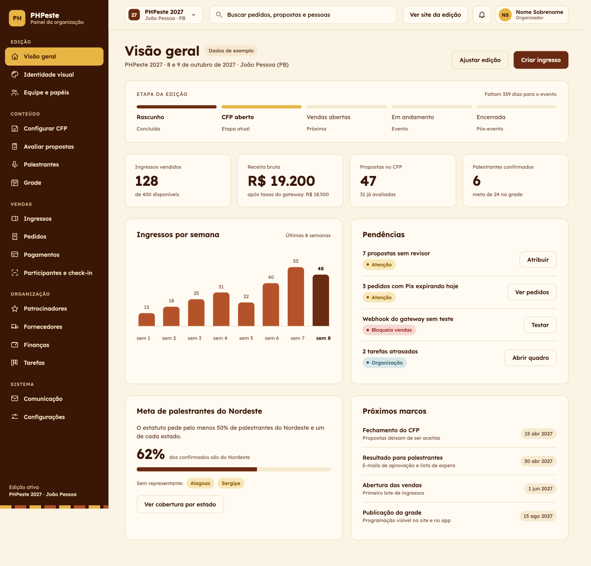

# PHPeste Platform

Plataforma única para organizar o [PHPeste](https://phpeste.dev), o evento anual, comunitário e itinerante de PHP do Nordeste. Cada ano a comunidade anfitriã abre uma nova edição na plataforma, configura a identidade visual e cuida de fornecedores, CFP, programação, ingressos e check-in sem reinventar ferramentas.

A primeira edição a usar a plataforma é o PHPeste 2027, em João Pessoa (PB), organizado pela comunidade PHP-PB.

> **Status:** Marco 0. Backend (Laravel + `internachi/modular`, 10 módulos do MVP já scaffolded) e front-admin (Nuxt, a partir do `base_nuxt_modular`) já rodam localmente. `front-public` e `app` ainda não foram iniciados.

## Por que esta plataforma existe

O PHPeste muda de cidade e de comunidade anfitriã a cada ano. Isso é o que faz o evento ser do Nordeste inteiro, mas também significa que quem organiza uma edição costuma começar do zero: monta planilhas, formulários e um site novo, e quando o evento acaba, o que foi aprendido e os contatos construídos ficam com quem organizou aquele ano.

Esta plataforma existe para mudar isso. Os motivos:

- **Cada edição não deveria recomeçar do zero.** A comunidade anfitriã recebe uma ferramenta pronta para CFP, programação, ingressos, patrocinadores e check-in, e passa o tempo organizando o evento em vez de montar ferramentas.
- **A memória do evento precisa ficar.** Palestrantes, fornecedores e patrocinadores são cadastros globais. Quem organiza em 2028 enxerga quem já participou, com quem já se trabalhou e o que deu certo.
- **Cada edição tem a sua cara.** A identidade visual muda a cada ano e a cada cidade. Cores, logo, fontes e textos são configurados dentro da plataforma, sem depender de uma pessoa de tecnologia para refazer o site.
- **A comunidade é dona do dinheiro e dos dados.** A plataforma não toca nos pagamentos: cada comunidade conecta o gateway que preferir (Asaas ou Mercado Pago) e recebe direto na própria conta. Os dados de cada edição ficam isolados das demais.
- **O checkout precisa caber no site de cada ano.** A compra de ingresso pode ser uma página hospedada pela plataforma, um componente embutido no site da edição ou usada pela API, conforme a necessidade de quem organiza.
- **Participante e organização na mesma base.** Quem compra o ingresso, envia proposta e usa o app tem uma conta só, em todas as edições.
- **Um projeto aberto e comunitário.** Por ser feito para o PHPeste e mantido em comunidade, qualquer pessoa pode propor melhorias, e a continuidade não depende de um único voluntário.

Em uma frase: transformar a organização do PHPeste em algo que se herda de um ano para o outro, em vez de algo que se reconstrói a cada edição.



## O que a plataforma cobre

- **Comunidades e edições:** cada edição tem equipe, papéis, status e tema próprios.
- **Identidade configurável:** cores, logo, fontes e textos por edição, aplicados ao site, ao admin e ao app sem novo deploy.
- **CFP:** submissão, avaliação por curadores, decisão em lote e confirmação dos palestrantes.
- **Programação:** salas, sessões e grade com validação de conflitos.
- **Ingressos e checkout:** tipos, lotes, cupons, Pix, cartão e boleto, com webhooks idempotentes.
- **Check-in:** leitura de QR no credenciamento.
- **App do participante:** programação, agenda pessoal e ingresso com QR.
- **Fornecedores, patrocinadores, despesas e tarefas** da organização.

## Princípios

- **Uma instalação, um banco.** Tudo que pertence a uma edição carrega `edition_id`; usuários, perfis de palestrante e fornecedores são globais e preservam o histórico entre edições.
- **A plataforma não toca no dinheiro.** Cada comunidade conecta as chaves do próprio gateway e recebe direto na sua conta.
- **API primeiro.** Admin, site e app consomem a mesma API, e nenhuma regra de negócio vive só em um cliente.
- **Módulos independentes.** Os módulos conversam por eventos de domínio e contratos, nunca por chamadas diretas entre models.

## Stack

| Parte | Tecnologia |
| --- | --- |
| Backend | Laravel 13, PHP 8.4, modularizado com [internachi/modular](https://github.com/InterNACHI/modular) |
| Documentação da API | [Scramble](https://github.com/dedoc/scramble) (OpenAPI) |
| Admin | Nuxt, a partir do [base_nuxt_modular](https://github.com/tecrodrigocastro/base_nuxt_modular) |
| Site público e checkout | Nuxt (SSR) |
| App do participante | Flutter, a partir do [base_clean_arch_bloc](https://github.com/tecrodrigocastro/base_clean_arch_bloc) |
| Autenticação | Laravel Sanctum (token Bearer) |
| Filas e cache | Redis |
| Qualidade | Pint, Larastan, Pest e Playwright |

## Estrutura do repositório

```text
phpeste-platform/
├── infra/          # Docker Compose (dev e produção), CI/CD, proxy, backups
├── docs/           # planejamento, ADRs e guia para comunidades anfitriãs
├── backend/        # Laravel: API, filas, webhooks (módulos em app-modules/)
├── front-admin/    # Nuxt: painel da organização
├── front-public/   # (planejado) Nuxt: checkout, CFP, conta do participante, site template
└── app/            # (planejado, Marco 3) Flutter: app do participante
```

## Módulos do backend

Cada módulo vive em `backend/app-modules/<nome>` com namespace `PHPeste\<Nome>`.

| Módulo | Responsabilidade |
| --- | --- |
| Identity | Usuários, login, perfis e papéis por edição |
| Community | Comunidades, edições, equipe e onboarding de nova edição |
| Branding | Tema, domínio e tokens para site e app |
| Cfp | Chamada, trilhas, propostas, avaliação e decisão |
| Program | Salas, sessões, grade e agenda pessoal |
| Ticketing | Tipos, lotes, cupons, pedidos, ingressos e QR |
| Payments | Interface de gateway, drivers (Asaas, Mercado Pago), webhooks e estornos |
| CheckIn | Leitura de QR, credenciamento e equipe |
| Notifications | E-mail transacional e push |
| Sponsors | Cotas, contrapartidas e contratos |
| Suppliers | Cadastro de fornecedores e contratos por edição |
| Finance | Orçamento, despesas e comprovantes |
| Tasks | Kanban da organização por edição |
| Engagement | Feedback de sessão, sorteio e certificados |
| Audit | Trilha de ações sensíveis |

Para criar um módulo novo:

```bash
php artisan make:module <nome>
composer update modules/<nome>
```

## Como rodar

- **Backend** (`backend/`):

  ```bash
  cd backend
  composer install
  cp .env.example .env && php artisan key:generate
  php artisan migrate
  php artisan serve   # http://localhost:8000
  composer check      # pint + phpstan + rector --dry-run + pest
  ```

  Ou via Docker (MySQL + Redis + Horizon + Mailpit): `cd infra && cp .env.example .env && docker compose up -d`.

- **Admin** (`front-admin/`):

  ```bash
  cd front-admin
  npm install
  cp .env.example .env   # NUXT_PUBLIC_API_BASE=http://localhost:8000/api/v1
  npm run dev
  ```

- **Site público e checkout** (`front-public/`): ainda não iniciado.
- **App** (`app/`): a definir no Marco 3.

## Documentação

Tudo o que não cabe neste README fica em [`docs/`](docs/):

- [`produto.md`](docs/produto.md): visão, módulos do MVP e fases seguintes, decisões em aberto
- [Design do admin](https://claude.ai/artifact/3B7ZWqjBQPDFZ5vhGgNs4N#page-dcb81aee8d83): protótipo/telas do `front-admin`
- ADRs com o porquê de cada decisão de arquitetura (a escrever)
- Guia para a comunidade anfitriã: criar a edição, conectar o gateway, tematizar e abrir o CFP (a escrever)


## Segurança e privacidade

Credenciais de gateway são criptografadas e nunca devolvidas pela API. Webhooks têm assinatura validada e são idempotentes. Cada edição tem política de privacidade própria, e os dados de uma edição são isolados das demais. Para reportar uma vulnerabilidade, a definir.

## Contribuindo

A definir: guia de contribuição, código de conduta e licença.
