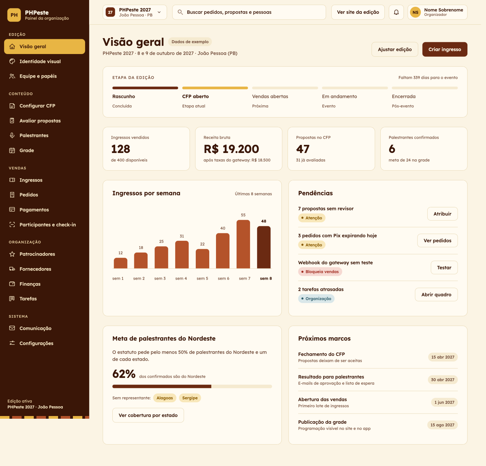

# PHPeste Platform

Plataforma única para organizar o [PHPeste](https://phpeste.dev), o evento anual, comunitário e itinerante de PHP do Nordeste. Cada ano a comunidade anfitriã abre uma nova edição na plataforma, configura a identidade visual e cuida de fornecedores, CFP, programação, ingressos e check-in sem reinventar ferramentas.

A primeira edição a usar a plataforma é o PHPeste 2027, em João Pessoa (PB), organizado pela comunidade PHP-PB.

> **Status (27/11/2026):** Marcos 0, 1 e 2 concluídos. Já funcionam o núcleo (comunidades, edições, equipe, identidade visual, domínios), o CFP completo, a venda de ingressos com Pix e cartão no gateway da própria comunidade, e a gestão da organização (patrocinadores, fornecedores, finanças, tarefas, modelos de e-mail). No site da edição já existem o formulário do CFP, a área do palestrante, o checkout e a conta do participante. Próximo: Marco 3 (programação, check-in, site da edição e checkout embutível) e o app mobile (Marco 5), cuja base já está em `app/`.

## Por que esta plataforma existe

O PHPeste muda de cidade e de comunidade anfitriã a cada ano. Isso é o que faz o evento ser do Nordeste inteiro, mas também significa que quem organiza uma edição costuma começar do zero: monta planilhas, formulários e um site novo, e quando o evento acaba, o que foi aprendido e os contatos construídos ficam com quem organizou aquele ano.

Esta plataforma existe para mudar isso. Os motivos:

- **Cada edição não deveria recomeçar do zero.** A comunidade anfitriã recebe uma ferramenta pronta para CFP, programação, ingressos, patrocinadores e check-in, e passa o tempo organizando o evento em vez de montar ferramentas.
- **A memória do evento precisa ficar.** Palestrantes, fornecedores e patrocinadores são cadastros globais. Quem organiza em 2028 enxerga quem já participou, com quem já se trabalhou e o que deu certo.
- **Cada edição tem a sua cara.** A identidade visual muda a cada ano e a cada cidade. Cores, logo, fontes e textos são configurados dentro da plataforma, sem depender de uma pessoa de tecnologia para refazer o site.
- **A comunidade é dona do dinheiro e dos dados.** A plataforma não toca nos pagamentos: cada comunidade conecta o gateway que preferir (Asaas ou Mercado Pago) e recebe direto na própria conta. Os dados de cada edição ficam isolados das demais.
- **O checkout precisa caber no site de cada ano.** A compra de ingresso pode ser uma página hospedada pela plataforma, um componente embutido no site da edição ou usada pela API, conforme a necessidade de quem organiza.
- **Participante e organização na mesma base.** Quem compra o ingresso, envia proposta e usa o app tem uma conta só, em todas as edições.
- **Um projeto aberto e comunitário.** Por ser feito para o PHPeste e mantido em comunidade, qualquer pessoa pode propor melhorias, e a continuidade não depende de um único voluntário.

Em uma frase: transformar a organização do PHPeste em algo que se herda de um ano para o outro, em vez de algo que se reconstrói a cada edição.



## O que a plataforma cobre

Pronto:

- **Comunidades e edições:** cada edição tem equipe, papéis, convites, status e tema próprios. Uma edição nova pode nascer copiando a anterior.
- **Identidade configurável:** cores, logo, fontes e textos por edição, com pré-visualização e publicação, aplicados ao site sem novo deploy. Cada edição tem domínio próprio ou subdomínio, e a comunidade pode manter o site dela e usar a plataforma só para a área de palestrante e participante ([`docs/site-proprio.md`](docs/site-proprio.md)).
- **Contas:** cadastro, login por senha ou GitHub, recuperação de senha, perfil global e perfil de palestrante que valem para todas as edições.
- **CFP:** configuração da chamada, submissão com rascunho e coautores, convite direto, atribuição de revisores, avaliação (anônima ou não), decisão em lote com lista de espera e cota do Nordeste, confirmação do palestrante.
- **Ingressos:** tipos, lotes com virada automática, cupons, reserva de estoque sem venda acima do limite, pedidos com idempotência, emissão de ingresso com QR assinado, transferência, dados do crachá e importação de compradores de outras plataformas (Sympla, Even3, planilha).
- **Pagamentos:** Asaas e Mercado Pago com a conta da própria comunidade, Pix e cartão, webhooks assinados e idempotentes, reembolso total ou parcial e conciliação diária com o gateway.
- **Site da edição:** formulário do CFP e área do palestrante; checkout com Pix e cartão; conta do participante com os ingressos (o QR abre sem internet), crachá, transferência e histórico de pedidos.
- **Gestão da organização:** patrocinadores (funil, cotas e entregas), fornecedores (cadastro global e contratos por edição), finanças (receitas, despesas, orçamento), tarefas (kanban com lembretes), modelos de e-mail por edição e trilha de auditoria.

A fazer (Marcos 3, 4 e 5, ver o [board](https://github.com/orgs/PHPeste/projects/2)):

- **Programação:** salas, sessões, grade com validação de conflitos e agenda pessoal.
- **Check-in:** leitura de QR no credenciamento, com modo offline.
- **Site da edição completo** (template, SEO, termos e LGPD) e **checkout embutível** no site da comunidade.
- **App mobile** (Marco 5): um app só para participante (início, programação, agenda, ingresso que abre sem internet, transferência, notificações), palestrante (propostas e confirmação) e equipe (check-in com leitura de QR, busca e fila offline).
- **Push**, feedback, certificados, sorteio, relatórios e operação (carga, backups, runbook).

## Princípios

- **Uma instalação, um banco.** Tudo que pertence a uma edição carrega `edition_id`; usuários, perfis de palestrante e fornecedores são globais e preservam o histórico entre edições.
- **A plataforma não toca no dinheiro.** Cada comunidade conecta as chaves do próprio gateway e recebe direto na sua conta.
- **API primeiro.** Admin, site e app consomem a mesma API, e nenhuma regra de negócio vive só em um cliente.
- **Módulos independentes.** Os módulos conversam por eventos de domínio e contratos, nunca por chamadas diretas entre models.

## Stack

| Parte | Tecnologia |
| --- | --- |
| Backend | Laravel 13, PHP 8.4, modularizado com [internachi/modular](https://github.com/InterNACHI/modular) |
| Documentação da API | [Scramble](https://github.com/dedoc/scramble) (OpenAPI) |
| Admin | Nuxt, a partir do [base_nuxt_modular](https://github.com/tecrodrigocastro/base_nuxt_modular) |
| Site público e checkout | Nuxt (SSR) |
| App mobile | Flutter 3.50, a partir do [base_clean_arch_bloc](https://github.com/tecrodrigocastro/base_clean_arch_bloc) (clean architecture com BLoC) |
| Autenticação | Laravel Sanctum (token Bearer) |
| Filas e cache | Redis |
| Qualidade | Pint, Larastan, Pest e Playwright |

## Estrutura do repositório

```text
phpeste-platform/
├── infra/          # Docker Compose (dev e produção), CI/CD, proxy, backups
├── docs/           # planejamento, ADRs e guia para comunidades anfitriãs
├── backend/        # Laravel: API, filas, webhooks (módulos em app-modules/)
├── front-admin/    # Nuxt: painel da organização
├── front-public/   # Nuxt SSR: área do palestrante e participante, checkout e site da edição, por host (ou só a área, quando a comunidade tem site próprio)
└── app/            # Flutter: app do participante, palestrante e equipe de check-in
```

## Módulos do backend

Cada módulo vive em `backend/app-modules/<nome>` com namespace `PHPeste\<Nome>`.

| Módulo | Responsabilidade | Situação |
| --- | --- | --- |
| Identity | Usuários, login por senha e GitHub, recuperação de senha, perfis | Pronto |
| Community | Comunidades, edições com máquina de estados, equipe, papéis, convites, nova edição a partir da anterior | Pronto |
| Branding | Tema publicado, logos, domínios por edição, resolução pelo host, site próprio | Pronto |
| Cfp | Chamada, trilhas, propostas, revisores, avaliação, decisão, confirmação | Pronto |
| Ticketing | Tipos, lotes, cupons, pedidos, ingressos com QR, participantes, transferência, importação, conciliação | Pronto |
| Payments | Contrato de gateway, Asaas e Mercado Pago, webhooks, reembolsos | Pronto |
| Notifications | E-mail transacional por edição, modelos editáveis, webhooks do Resend | E-mail pronto; push no Marco 3 |
| Sponsors | Funil, cotas, contrapartidas e entregas | Pronto |
| Suppliers | Fornecedores globais e contratos por edição | Pronto |
| Finance | Receitas, despesas, comprovantes e orçamento | Pronto |
| Tasks | Kanban da organização com lembretes | Pronto |
| Audit | Trilha de ações sensíveis | Pronto |
| Program | Salas, sessões, grade e agenda pessoal | Só o esqueleto (Marco 3) |
| CheckIn | Leitura de QR, credenciamento, modo offline | Só o esqueleto (Marco 3) |
| Engagement | Feedback de sessão, sorteio e certificados | Só o esqueleto (Marco 4) |

Para criar um módulo novo:

```bash
php artisan make:module <nome>
composer update phpeste/<nome>
```

## Telas

- **Painel da organização** (`front-admin/`): visão geral, comunidades e edições, equipe, identidade, configurações, meu perfil, CFP (configuração e avaliação), palestrantes, ingressos (tipos, lotes e cupons), pedidos e reembolso, pagamentos (gateway e webhook), participantes, patrocinadores, fornecedores, finanças, tarefas e comunicação (modelos de e-mail). As telas seguem o [design do admin](https://claude.ai/artifact/3B7ZWqjBQPDFZ5vhGgNs4N#page-dcb81aee8d83).
- **Site da edição** (`front-public/`): página inicial da área, `/cfp`, `/palestrante/propostas`, `/ingressos` e `/checkout/pedido/{id}` (compra), `/conta/ingressos` e `/conta/pedidos` (participante).

## Como rodar

- **Backend** (`backend/`):

  ```bash
  cd backend
  composer install
  cp .env.example .env && php artisan key:generate
  php artisan migrate
  php artisan serve   # http://localhost:8000
  composer check      # pint + phpstan + rector --dry-run + pest
  ```

  Ou via Docker (MySQL, Redis, Horizon, scheduler e Mailpit): `infra/dev.sh up` (ver [`infra/README.md`](infra/README.md)). Sem Docker, dá para usar SQLite com `DB_CONNECTION=sqlite`, `QUEUE_CONNECTION=sync` e `CACHE_STORE=file` no `.env`. As rotinas (expirar reservas, virar lotes, conciliar pagamentos, reprocessar webhooks, lembretes) rodam pelo `php artisan schedule:work`.

- **Admin** (`front-admin/`):

  ```bash
  cd front-admin
  npm install
  cp .env.example .env   # NUXT_PUBLIC_API_URL=http://localhost:8000/api/v1
  npm run dev
  ```

- **Site da edição** (`front-public/`): a edição e o tema são resolvidos pelo endereço ([ADR 0008](docs/adr/0008-front-public-por-host.md)), então é preciso cadastrar o domínio no painel.

  ```bash
  cd front-public
  npm install
  cp .env.example .env
  NUXT_TRUST_FORWARDED_HOST=true npm run dev   # http://localhost:3000
  curl -H 'X-Forwarded-Host: <domínio da edição>' http://localhost:3000/
  ```

  Os testes dos fronts e do backend rodam com `npm test` e `npm run test:e2e` (Playwright, com a API simulada) nos fronts e `composer check` no backend; o CI roda os mesmos comandos em todo PR.
- **App** (`app/`): base pronta; as telas entram no Marco 5.

  ```bash
  cd app
  flutter pub get
  flutter run --flavor dev --dart-define-from-file=env/dev.json   # emulador Android, API local em 10.0.2.2:8000
  flutter analyze && flutter test
  ```

## Documentação

Tudo o que não cabe neste README fica em [`docs/`](docs/):

- [`produto.md`](docs/produto.md): visão, módulos, o que está pronto e o que falta, decisões em aberto
- [`arquitetura/`](docs/arquitetura/): documento visual da arquitetura ([PDF](docs/arquitetura/PHPeste_Arquitetura.pdf)): tenancy por edição, módulos e como conversam, banco, papéis, fluxos de compra, CFP e dinheiro, segurança, telas
- [`api.md`](docs/api.md): convenções da API (rotas, erros, idempotência, rate limit, CORS, paginação, Scramble)
- [`guia-gateways.md`](docs/guia-gateways.md): como a comunidade conecta o Asaas ou o Mercado Pago
- [`site-proprio.md`](docs/site-proprio.md): usar a plataforma com o site da própria comunidade
- [`deploy/dominios-e-tls.md`](docs/deploy/dominios-e-tls.md): proxy, domínios das edições e certificados
- [`adr/`](docs/adr/): o porquê de cada decisão de arquitetura (0001–0009)
- [Design do admin](https://claude.ai/artifact/3B7ZWqjBQPDFZ5vhGgNs4N#page-dcb81aee8d83): protótipo das telas do `front-admin`
- [Design do app](https://claude.ai/artifact/3yAeWXmnxFSdActqPdqt7K#page-dcb81aee8d83): telas e fluxos do `app/` (participante, palestrante e equipe)
- Guia para a comunidade anfitriã: criar a edição, conectar o gateway, tematizar e abrir o CFP (a escrever)


## Segurança e privacidade

- Os dados de uma edição ficam isolados das demais (escopo global por `edition_id`, ver [ADR 0007](docs/adr/0007-tenancy-edicao-como-tenant.md)), e cada papel da equipe só vê o que precisa (o financeiro não vê acessibilidade, o check-in não vê pedidos).
- Credenciais de gateway são cifradas e nunca devolvidas pela API ([ADR 0006](docs/adr/0006-politica-de-segredos.md)). CPF de quem compra e pedidos de acessibilidade também ficam cifrados.
- Número de cartão nunca passa pela plataforma: o cartão é digitado na página do gateway ou nos campos seguros do Mercado Pago, e a API recusa campos de cartão.
- Webhooks têm assinatura validada, entram numa caixa de entrada idempotente e o status sempre vem de uma consulta ao gateway.
- O QR do ingresso é assinado (HMAC), não leva dado pessoal e muda de versão quando o ingresso é transferido.
- Ações sensíveis (pagamento manual, reembolso, transferência, mudança de equipe) ficam na trilha de auditoria.

Política de privacidade por edição e consentimento (LGPD) entram no Marco 3. Para reportar uma vulnerabilidade, a definir.

## Contribuindo

Ver [`CONTRIBUTING.md`](CONTRIBUTING.md). Código de conduta e licença: a definir.
