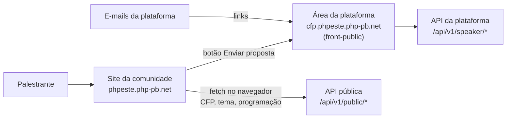

# Site próprio da edição

Cada edição pode publicar o site de duas formas:

| Modo | Quem faz o site | O que a plataforma serve |
| --- | --- | --- |
| **Site da plataforma** (`platform`, padrão) | O front-public gera o site com o tema da edição | Tudo: páginas de conteúdo, CFP, área do palestrante, conta e checkout |
| **Site próprio** (`external`) | A comunidade mantém o próprio site (ex.: `phpeste.php-pb.net`) | Só a área de palestrante e participante, num subdomínio da comunidade (ex.: `cfp.phpeste.php-pb.net`) |

No modo site próprio, o site da comunidade continua com o conteúdo dela (home, local, patrocinadores) e:

- **leva para a plataforma** o que precisa de conta, rascunho ou pagamento: enviar proposta, acompanhar a proposta, confirmar presença, logística de viagem e, no Marco 2, comprar ingresso;
- **consome a API pública** para mostrar o que muda durante o ano sem editar o site na mão: status e prazo do CFP, trilhas, tema e, quando existirem, programação e palestrantes.

## Por que a área do palestrante não vai para dentro do site da comunidade

Enviar proposta envolve entrar com e-mail ou GitHub, rascunho que sobrevive a recarregar a página, coautores, edição enquanto o CFP está aberto e, depois do resultado, confirmação e logística. Refazer isso em cada site seria manter o mesmo fluxo em vários lugares, com regras de segurança e LGPD repetidas. A plataforma já renderiza essa área com o tema publicado da edição (cores, fonte, logo), então ela parece parte do site.

Usar um **subdomínio do domínio da comunidade**, e não um endereço da plataforma, mantém a marca e a confiança do palestrante (ele continua em `*.php-pb.net`), e os e-mails da plataforma (proposta recebida, confirmação, lembretes) já apontam para o domínio verificado da edição (`EditionSites`).

## Como fica



## Passo a passo para a comunidade

1. **Escolher o subdomínio** da área do palestrante, por exemplo `cfp.` ou `palestrantes.` no domínio do site.
2. **Criar o CNAME** no DNS do domínio: `cfp.phpeste.php-pb.net` → valor de `PUBLIC_CNAME_TARGET` da instalação (ex.: `edicoes.phpeste.dev`). Se o provedor não aceitar CNAME, usar o TXT de verificação (ver [`deploy/dominios-e-tls.md`](deploy/dominios-e-tls.md)).
3. **Cadastrar o domínio** no painel, em Configurações → Domínio, e marcar como principal. O painel mostra o estado da verificação. O certificado HTTPS é emitido sozinho no primeiro acesso.
4. **Marcar "Site próprio"** em Configurações e informar o endereço do site (`https://phpeste.php-pb.net`). A partir daí:
   - a raiz do subdomínio (`cfp.phpeste.php-pb.net/`) e as páginas de conteúdo redirecionam para o site da comunidade;
   - o site passa a poder chamar a API pública pelo navegador (CORS liberado para esse endereço).
5. **Pôr os links no site**:
   - "Enviar proposta" → `https://cfp.phpeste.php-pb.net/cfp`
   - "Minhas propostas" → `https://cfp.phpeste.php-pb.net/palestrante/propostas`
   - no Marco 2, "Comprar ingresso" → `https://cfp.phpeste.php-pb.net/ingressos` (ou um subdomínio próprio, como `ingressos.`)
6. **Opcional: mostrar dados ao vivo** com a API pública (abaixo).

## API pública para o site da comunidade

Não precisa de login. Respostas com cache curto e `ETag`. O `edition_id` aparece no painel, em Configurações.

| Endpoint | Para quê |
| --- | --- |
| `GET /api/v1/public/editions/{id}/cfp` | Status (`open`, `scheduled`, `closed`…), abertura, fechamento, resultado, propostas por pessoa, trilhas e as opções do formulário (formatos, níveis, idiomas) |
| `GET /api/v1/public/editions/{id}/theme` | Tema publicado (cores, fontes, raio, logos), para o site usar as mesmas cores que a área da plataforma |
| `GET /api/v1/public/communities/{comunidade}/editions/{edição}` | Dados públicos da edição (nome, datas, local) |
| Programação e palestrantes confirmados | Marco 3 |

Exemplo, para trocar o botão do CFP conforme o status:

```html
<a id="cfp" href="https://cfp.phpeste.php-pb.net/cfp">Enviar proposta</a>
<script>
  fetch('https://api.phpeste.dev/api/v1/public/editions/EDITION_ID/cfp')
    .then((response) => response.json())
    .then(({ data }) => {
      const link = document.getElementById('cfp')
      if (data.status === 'open') {
        const closes = new Date(data.closes_at).toLocaleDateString('pt-BR', { day: 'numeric', month: 'long' })
        link.textContent = `Enviar proposta até ${closes}`
      } else {
        link.textContent = data.status_label
        link.removeAttribute('href')
      }
    })
</script>
```

Se a API estiver fora do ar, o link continua funcionando: a área da plataforma mostra o formulário aberto ou encerrado conforme a janela do CFP.

## O que a plataforma serve no subdomínio, no modo site próprio

| Caminho | O quê |
| --- | --- |
| `/cfp` | Formulário de proposta em 3 passos, com conta, rascunho e aviso de anonimato (P03, #78) |
| `/palestrante/propostas` | Propostas da pessoa, edição enquanto o CFP está aberto |
| `/palestrante/propostas/{id}` | Uma proposta, com a confirmação de presença de quem foi aprovado (é o link dos e-mails de aprovação e lembrete) |
| `/palestrante/logistica` | Viagem e hospedagem de quem confirmou |
| `/entrar`, `/conta` | Login, cadastro e conta |
| `/ingressos`, `/pedidos` | Checkout e pedidos (Marco 2) |
| `/` e qualquer outra página | Redireciona para o site da comunidade |

## Estado atual

| Parte | Situação |
| --- | --- |
| Domínio próprio verificado por CNAME/TXT e HTTPS automático | Pronto (B13) |
| Tema publicado e CFP públicos pela API | Pronto |
| E-mails do palestrante com links para o domínio verificado | Pronto |
| Modo site próprio na edição, `site_url` real e CORS por edição | Pronto (B48): `site_mode` e `external_site_url` na edição, CORS liberado só nas rotas `/api/v1/public/*` para a origem do site de edição publicada, e `GET /public/resolve` com `site_mode` e `external_site_url` |
| Área da plataforma no subdomínio (front-public) | Base pronta (P01): resolve a edição pelo host, aplica o tema sem flash e manda a raiz para o site da comunidade. Formulário de proposta no #78 (P03) |
| Tela de domínio e de site próprio no painel | Pronto (A24): Configurações → Domínio e site |
